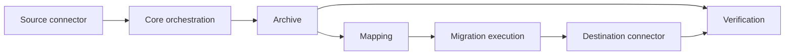

# Architecture

Status: draft. The package implements discovery, paged export, archive byte and envelope checks, and scalar preview and import. The broader module behaviors below describe the target design.

Core coordinates source discovery, paged export, archive publication, migration, and verification. Core owns no HTTP transport, provider field names, credentials, or framework state. Provider adapters depend on core contracts. Core depends on those contracts and application-injected components. Use value objects where they enforce invariants and introduce abstractions when multiple call sites require a shared boundary.

| Module | Planned responsibility |
|---|---|
| Contracts | Capability interfaces, data shapes, and classified failures |
| Archive | Serialization, streaming I/O, validation, atomic publication |
| Mapping | Pure field transformations and structured outcomes |
| Migration | Immutable plans, checkpoints, identity lookup, retries, and execution |
| Verification | Integrity checks, comparable field checks, and coverage |
| Exceptions | Safe package-level error types |

## Mapping

Match stable field IDs and require explicit mappings for ambiguous fields. Compile a mapping against source and destination schema fingerprints. Runtime outcomes distinguish missing, explicit null, converted, unsupported, and invalid values. Omit missing fields unless a default is explicitly configured. Clear destination data only if the mapping allows null and the destination supports it. Use registered type conversions with declared loss behavior. Preserve original stream identities independently from mapped values. Resolve relationships through a durable source-to-destination ID map.

## Planning and execution

Build a read-only plan keyed by archive digest, schemas, mapping version, target scope, and options. Compare that identity on resume. Order parent records ahead of dependents. Report cycles as blocked unless the target supports creation followed by relationship updates. A dry run reads schemas and validates inputs without writing to the destination.

Persist write intent before calling a destination and acknowledge progress only after outcomes and ID mappings are durably recorded. Persist idempotency keys per operation. Retry ambiguous writes only when the target supports deduplication or reconciliation by a stable lookup. Halt on uncertain outcomes otherwise. Retry classified transient errors with bounded attempts, jitter and Retry-After. Surface permanent failures and blocked dependents. Checkpoints use storage-assisted conditional updates to prevent stale writers from advancing progress.

## Verification

Check archive byte integrity, stream counts, schema conformance, duplicate IDs, and references independently of target verification. Compare only fields declared comparable by the mapping, using explicit normalization. Report verified, mismatched, unsupported, failed mapping, and unverified outcomes with separate counts and coverage. An intact archive can still have partial export coverage. A verified field does not imply cross-platform equivalence.

Keep memory bounded by page size, maximum record size, and fixed I/O buffers. Delegate large ID indexes and checkpoints to injected stores. Use [Semantic Versioning](https://semver.org/) for the package and independent versions for serialized formats. Document breaking changes and migration paths explicitly.
